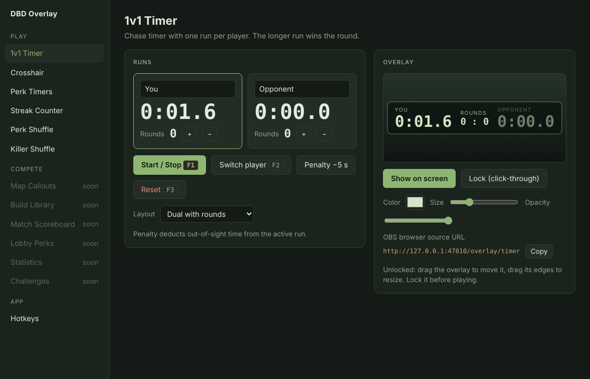

# DBD Overlay (working name)

Free, open source overlay toolkit for Dead by Daylight. Built for scrim, league and 1v1 players, usable by anyone.

Not affiliated with or endorsed by Behaviour Interactive. Behaviour has not published a position on overlay tools: use at your own risk. This app reads the screen only. It never reads game memory and never sends input to the game.



## Tools

Every tool has an in-app panel and an overlay. An overlay can sit over the game (borderless or windowed mode) or go into OBS as a browser source from its local URL.

| Tool | What it does |
|---|---|
| 1v1 Timer | Two runs, round score, round history, penalty key, warning color near the time to beat |
| Crosshair | Cross, dot, circle or T. Size, thickness, gap, outline, offset. Profiles per killer |
| Perk Timers | Arm timers, fire all with one key or each with its own key. Presets, tone per timer |
| Streak Counter | Current, best, attempt. One streak per character. Win and loss keys, undo |
| Perk Shuffle | Random loadout from a perk pool, lockable slots |
| Killer Shuffle | Random killer from a roster, no repeats until all are played |
| Map Callouts | Clock callout image for the current map. Map read from the screen, locks for the match, unlocks at the end screen |
| Build Library | Saved builds checked against a league ruleset, per killer. Imports DBDLeague, Champions of the Fog and other presets |
| Killer Reference | Speed, terror radius, perks, and league tier and maps per killer |
| Lobby Perks | Four survivors' perks, with team rule check |
| Match Scoreboard | Sets, per-survivor hook states, gens left, kills. Mirror or win-condition format |
| Statistics | Local match log, win rate per character |
| Challenges | Long runs with stacking rules |
| My League | Roster and roles, local only |

Not built: party, live league tracking, friends, stat comparison. They need a server. See `docs/ONLINE.md`.

## Status

Developed and tested on Linux. On Windows, beside the game, these are untested: overlays over the game, hotkeys while the game is focused, map detection on real game frames, pass-through input. Checklist: `docs/WINDOWS-TEST.md`.

## Map detection accuracy

Measured with `scripts/ocr-eval.js` on 26 real game screenshots (Steam community and wiki images, 1080p to 4K), bundled reader (Tesseract):

| Set | Result |
|---|---|
| English trial-start frames with readable text | 13 of 13 correct, 0.1 to 0.6 s each |
| English end-of-match screens | 7 of 7 recognized |
| Frames with no map name (end screens, TAB screen) | 0 false map detections |
| Non-English clients (Russian, Spanish, German) | Not detected. English game language is required |
| Maps added to the game after the catalog was last updated | Not detected until added to `data/maps.json` |

Not measured: live capture on Windows, and the Windows built-in reader.

## Run from source

```bash
npm install
```

```bash
npm start
```

```bash
npm test
```

## Input modes

| Mode | Behavior |
|---|---|
| Standard | The bound key is taken by the app and does not reach the game. Keyboard only. No extra rights |
| Pass-through | The key also reaches the game (crouch can start the timer). Mouse side and middle buttons can be bound. May need the app to run as administrator |

## Data, art and credits

| Item | Source | Terms |
|---|---|---|
| Perk and character names | dbd.tricky.lol community API, current names from deadbydaylight.wiki.gg | Names are Behaviour's |
| Perk icons, portraits (`assets/game/`) | deadbydaylight.wiki.gg | Property of Behaviour Interactive. Not under this project's license. See `assets/game/NOTICE.md` |
| Map list (`data/maps.json`) | Derived from Hens' callouts list | |
| Callout images | [Hens' Callouts](https://hens333.com/callouts), map art by Lethia, with work by Zexov, Broosley and Evo | Not shipped. Downloaded to the user's computer on request. They belong to their creators |
| League presets | [Balanced by Daylight](https://balancedbydaylight.com) by Kyle Starr and contributors | Not shipped. Fetched on request |
| Map detection approach | zxorshi/dbd-clock-overlay (MIT), H4RDC0RN/dbd-overlay, erktiky/DBDMap | |
| Timer features | Modeled on Truueh's DBD 1v1 Timer (feature reference only, no code) | |

## Layout

| Path | Contents |
|---|---|
| `src/main/tools.js` | All tool state and actions. Plain logic, unit tested |
| `src/main/main.js` | Windows, tray, local server (127.0.0.1 only), wiring |
| `src/main/detect.js` | Map catalog matching, lock session, OCR |
| `src/main/hooks.js` | Global input, both modes |
| `src/main/leagues.js` | League preset import |
| `src/ui/` | Main window |
| `src/overlay/` | Overlay pages, shared by app windows and OBS |
| `scripts/` | `update-data`, `update-assets`, `smoke` |

## License

MIT for the code. See `LICENSE`. Game art, callout images and league data are excluded as listed above.
